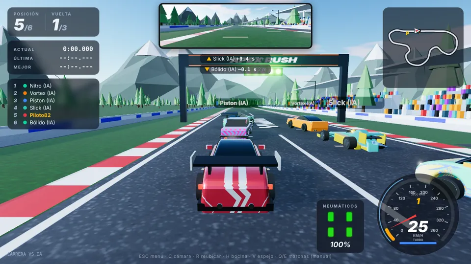
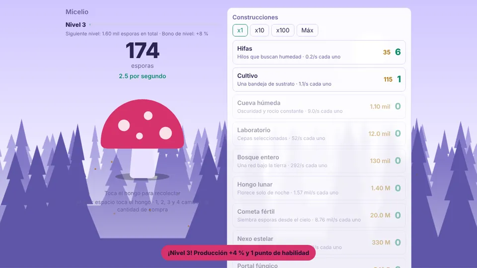
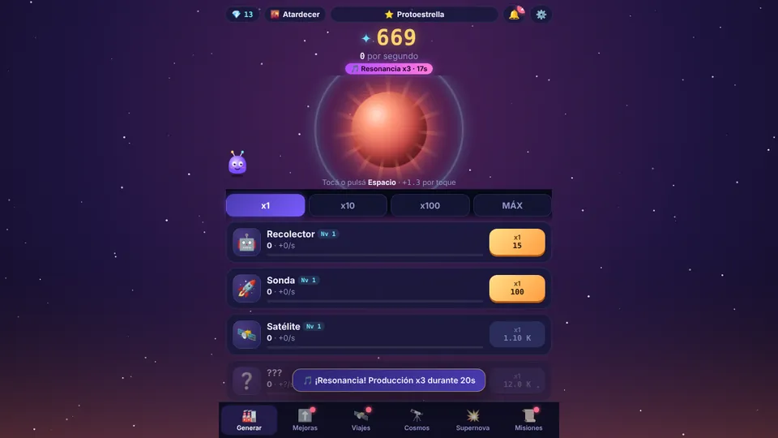
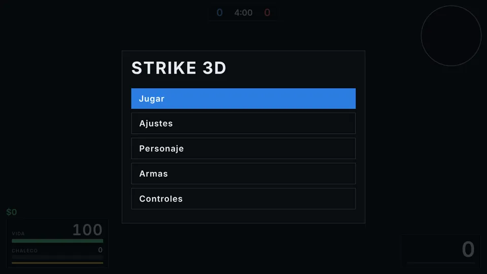
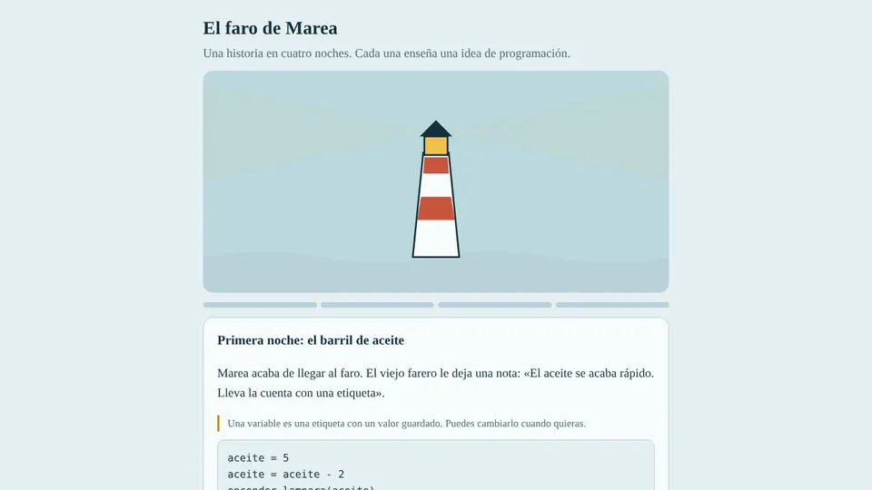

<h1 align="center">Hola, soy Gastón 👋</h1>

  Hago juegos que se juegan en el navegador, en el celu y en la red de tu casa, 
  y escribo historias para YouTube con personajes propios.

  <a href="https://bygastin.github.io/Bygastin/"><b>🌐 Ver mi portafolio</b></a>
  &nbsp;·&nbsp;
  <a href="https://bygastin.github.io/Bygastin/#probar">🍄 Jugar el mini idle</a>
  &nbsp;·&nbsp;
  <a href="https://bygastin.github.io/Bygastin/#contacto">✉️ Contacto</a>

---

## 🎮 Mis juegos

<table>
  <tr>
    <td width="50%" valign="top">
      
      <h3>APEX RUSH</h3>
      Carreras en 3D con gráficos en HD y multijugador por red local. Cada auto suena distinto y tiene skins para elegir.  
      <a href="https://bygastin.github.io/Bygastin/demos/apex-rush/">▶ Jugar</a> · <a href="demos/apex-rush">Código</a>
    </td>
    <td width="50%" valign="top">
      
      <h3>Micelio</h3>
      Juego incremental: un hongo que crece, suelta esporas y se expande. Mejoras, prestigio y niveles.  
      <a href="https://bygastin.github.io/Bygastin/demos/micelio/">▶ Jugar</a> · <a href="demos/micelio">Código</a>
    </td>
  </tr>
  <tr>
    <td width="50%" valign="top">
      
      <h3>Polvo Estelar</h3>
      Idle pensado para Android: juntás polvo estelar para hacer crecer una estrella, con mascota, viajes y supernovas.  
      <a href="https://bygastin.github.io/Bygastin/demos/polvo-estelar/">▶ Jugar</a> · <a href="demos/polvo-estelar">Código</a>
    </td>
    <td width="50%" valign="top">
      
      <h3>Strike 3D</h3>
      Shooter táctico en primera persona hecho en HTML, con modelos 3D y armas con disparo y daño.  
      <a href="https://bygastin.github.io/Bygastin/demos/strike-3d/">▶ Jugar</a> · <a href="demos/strike-3d">Código</a>
    </td>
  </tr>
  <tr>
    <td width="50%" valign="top">
      
      <h3>El faro de Marea</h3>
      Una historia en cuatro noches que enseña ideas de programación, sin necesidad de saber nada antes.  
      <a href="https://bygastin.github.io/Bygastin/demos/faro-de-marea/">▶ Jugar</a> · <a href="demos/faro-de-marea">Código</a>
    </td>
    <td width="50%" valign="top">
      <h3>🎬 La Banda del Barrio</h3>
      Serie de videos para YouTube armada con prompts, con Toño, Camperita, Pika y Javier como protagonistas.  
      <i>Episodios en camino.</i>
    </td>
  </tr>
</table>

## 🛠️ Con qué trabajo

`HTML` `CSS` `JavaScript` `Three.js` `Juegos 3D en el navegador` `Multijugador LAN` `Idle / incrementales` `Android` `Narrativa`

---

Tip: en el portafolio apretá la tecla <code>|</code> (o <code>`</code>) para abrir una terminal secreta.

